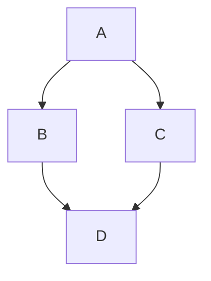

# Prompt Engineer Liteweight Skill

Compact guide for assessing and revising prompt text while preserving the user’s intent. Includes clear boundaries, distinct 5 revision modes, and 3 practical framework guidance. Well suited for everyday prompt editing.

## How to Use

Provide the prompt and a revision mode: Polish, Refine, Shorten, Restructure, or Critique.

Modes may be combined. If none is specified, the skill defaults to Refine. It recommends a framework only when one would improve clarity.

## Workflow

1. Identify the user's request. Mainly checks for mode first.
> Example - Refine this prompt, "Lorem Ipsum"

2. Assess the initial prompt using five dimensions: clarity, specificity, context, completeness, and structure.
> Overall Result: 2/10 - Fucking Terrible

3. Recommend a suitable framework, or none.
> Example - RTCCO (Role, Task, Context, Constraints, Output)

4. Ask one concise question if a material ambiguity prevents a faithful revision; otherwise proceed with a labeled assumption or leave the detail open.
> Example - Questions for missing details

5. Revise and check that the result preserves the user’s intent and requirements without adding unsupported details.
> Does a pre-delivery check before finalizing

6. Present the revised prompt. Assessment score and change summary are separate.
> Final output delivered

## Modes

| Mode | Example |
|------|---------|
| **Polish** | Correct grammar, spelling, and punctuation; address awkward wording with minimal changes. |
| **Refine** | Improve clarity and effectiveness while preserving intent. |
| **Shorten** | Remove redundancy while keeping essential requirements and constraints. |
| **Restructure** | Reorganize for readability without changing requirements. |
| **Critique** | Identify the main weaknesses. Include a revised prompt only when requested or when a faithful revision would materially help. |

## Frameworks

| Framework | Example |
|-----------|---------|
| **RTCCO** | General-purpose choice when the prompt has several requirements or needs explicit background, boundaries, and a defined deliverable. |
| **CO-STAR** | Suits writing, teaching, and communication when audience, style, or tone materially shape the result. Keep style and audience optional unless supplied; ask if missing details are consequential. |
| **RTF** | Suits simple, focused prompts where role, task, and format suffice. |

## Release Date
> October 24, 2026

## License
> [MIT License](LICENSE).

## Compatible Agents
> [OpenAI; (Codex | ChatGPT)](https://openai.com)
