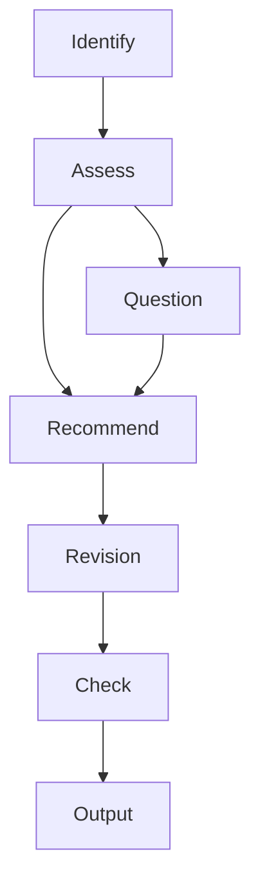

# Prompt Engineer Liteweight Skill

Compact skill for assessing and revising prompt text while preserving main intent. Includes clear boundaries, distinct 5 revision modes, and 3 practical framework guidance. Well-suited for everyday / complex prompt editing.

## Usage

Provide the prompt and a revision mode: Polish, Refine, Shorten, Restructure, or Critique.

It recommends a framework only when one would improve clarity.

> [!TIP]
> Modes may be combined. If none is specified, the skill defaults to Refine.

## Workflow

1. Identify the user's request.
> Example: Refine this prompt, "Lorem ipsum."

3. Assess the initial prompt using five dimensions: clarity, specificity, context, completeness, and structure.
> if the request did not clarify specifics, it will ask a few concise questions until missing gaps are complete then proceed.

5. Recommend a suitable framework if useful.

6. Revision of the prompt.

7. Performs checking that the result preserves the user’s intent and requirements without adding unsupported details before delivering.

8. Present the revised prompt.
> Assessment score and change summary are provided seperately.

## Modes

| Mode | Example |
|------|---------|
| **Polish** | Correct grammar, spelling, and punctuation; address awkward wording with minimal changes. |
| **Refine** | Improve clarity and effectiveness while preserving intent. |
| **Shorten** | Remove redundancy while keeping essential requirements and constraints. |
| **Restructure** | Reorganize for readability without changing requirements. |
| **Critique** | Identify the main weaknesses. Include a revised prompt only when requested or when a faithful revision would materially help. |

## Frameworks

| Framework | Example |
|-----------|---------|
| **RTCCO** | General-purpose choice when the prompt has several requirements or needs explicit background, boundaries, and a defined deliverable. |
| **CO-STAR** | Suits writing, teaching, and communication when audience, style, or tone materially shape the result. Keep style and audience optional unless supplied; ask if missing details are consequential. |
| **RTF** | Suits simple, focused prompts where role, task, and format suffice. |

## Compatible Agents
- OpenAI; [(Codex | ChatGPT)](https://openai.com)
- [ ] Anthropic; [(Claude | Claude Code)](google.com)

## Info
- Initial Release Date - October 24, 2026
- License - [MIT](LICENSE) License.
